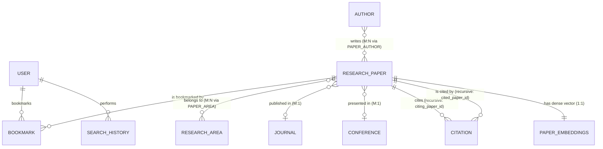

# Entity-Relationship (ER) Diagram & Structural Analysis

Based on the authoritative architectural design file **`ER DIAGRAM.png`** located in the project root:

---

## 1. Chen & Relational Architecture Diagram

---

## 2. Entity Identification & Attribute Specifications

### 2.1 USER
- **Primary Key:** `User_ID` (Integer, Auto-Increment)
- **Attributes:**
  - `Name` (VARCHAR(150), NOT NULL)
  - `Email` (VARCHAR(255), UNIQUE, NOT NULL)
  - `Password_Hash` (VARCHAR(255), bcrypt hash, NOT NULL)
  - `Role` (VARCHAR(20), CHECK role IN ('ADMIN', 'STUDENT'), NOT NULL)
- **Relationships:**
  - `1:N` with `SEARCH_HISTORY` (Relationship: `PERFORMS`)
  - `M:N` with `RESEARCH_PAPER` via `BOOKMARK` (Relationship: `BOOKMARKS`)

### 2.2 AUTHOR
- **Primary Key:** `Author_ID` (Integer, Auto-Increment)
- **Attributes:**
  - `Name` (VARCHAR(150), NOT NULL)
  - `Affiliation` (VARCHAR(255))
  - `Email` (VARCHAR(255))
- **Relationships:**
  - `M:N` with `RESEARCH_PAPER` via `PAPER_AUTHOR` (Relationship: `WRITES`)

### 2.3 RESEARCH_PAPER
- **Primary Key:** `Paper_ID` (Integer, Auto-Increment)
- **Attributes:**
  - `Title` (VARCHAR(500), NOT NULL)
  - `Abstract` (TEXT, NOT NULL)
  - `DOI` (VARCHAR(100), UNIQUE, NOT NULL)
  - `Publication_Date` (DATE, NOT NULL)
  - `Citation_Count` (INTEGER, DEFAULT 0, CHECK >= 0)
  - `Source` (VARCHAR(255), NOT NULL)
  - `Source_Type` (VARCHAR(50), CHECK IN ('JOURNAL', 'CONFERENCE', 'PREPRINT'))
  - `Journal_ID` (INTEGER, Foreign Key to `JOURNAL(journal_id)`)
  - `Conference_ID` (INTEGER, Foreign Key to `CONFERENCE(conference_id)`)
- **Relationships:**
  - `M:1` with `JOURNAL` (Relationship: `PUBLISHED_IN`)
  - `M:1` with `CONFERENCE` (Relationship: `PRESENTED_IN`)
  - `M:N` with `AUTHOR` via `PAPER_AUTHOR` (Relationship: `WRITES`)
  - `M:N` with `RESEARCH_AREA` via `PAPER_AREA` (Relationship: `BELONGS_TO`)
  - `M:N` Recursive self-referential relationship on `RESEARCH_PAPER` via `CITATION` (Relationship: `CITES`)
  - `1:1` with `PAPER_EMBEDDINGS`

### 2.4 JOURNAL
- **Primary Key:** `Journal_ID` (Integer, Auto-Increment)
- **Attributes:**
  - `Journal_Name` (VARCHAR(255), UNIQUE, NOT NULL)
  - `Publisher` (VARCHAR(255), NOT NULL)
  - `ISSN` (VARCHAR(30), UNIQUE, NOT NULL)
- **Relationships:**
  - `1:M` with `RESEARCH_PAPER` (Relationship: `PUBLISHED_IN`)

### 2.5 CONFERENCE
- **Primary Key:** `Conference_ID` (Integer, Auto-Increment)
- **Attributes:**
  - `Conference_Name` (VARCHAR(255), NOT NULL)
  - `Location` (VARCHAR(255), NOT NULL)
  - `Year` (INTEGER, CHECK year >= 1950 AND year <= 2100)
- **Relationships:**
  - `1:M` with `RESEARCH_PAPER` (Relationship: `PRESENTED_IN`)

### 2.6 RESEARCH_AREA
- **Primary Key:** `Area_ID` (Integer, Auto-Increment)
- **Attributes:**
  - `Area_Name` (VARCHAR(100), UNIQUE, NOT NULL)
  - `Description` (TEXT)
- **Relationships:**
  - `M:N` with `RESEARCH_PAPER` via `PAPER_AREA` (Relationship: `BELONGS_TO`)

### 2.7 SEARCH_HISTORY
- **Primary Key:** `Search_ID` (Integer, Auto-Increment)
- **Attributes:**
  - `User_ID` (INTEGER, Foreign Key to `USERS(user_id)`)
  - `Search_Query` (TEXT, NOT NULL)
  - `Search_Type` (VARCHAR(50), CHECK IN ('KEYWORD', 'SEMANTIC', 'HYBRID', 'FILTER'))
  - `Search_Date` (TIMESTAMP, DEFAULT CURRENT_TIMESTAMP)
- **Relationships:**
  - `N:1` with `USERS` (Relationship: `PERFORMS`)

### 2.8 CITATION (Recursive Directed Graph)
- **Composite Primary Key:** `(Citing_Paper_ID, Cited_Paper_ID)`
- **Attributes:**
  - `Citing_Paper_ID` (INTEGER, FK to `RESEARCH_PAPER(paper_id)`)
  - `Cited_Paper_ID` (INTEGER, FK to `RESEARCH_PAPER(paper_id)`)
- **Constraints:**
  - `CHECK (Citing_Paper_ID <> Cited_Paper_ID)`
  - Database trigger: `trg_prevent_self_citation`
  - Automatic counter triggers: `trg_increment_citation_count`, `trg_decrement_citation_count`

---

## 3. Cardinality Matrix & Relational Translation

| Relationship | Entity 1 | Entity 2 | Cardinality | Relational Implementation |
| :--- | :--- | :--- | :---: | :--- |
| **WRITES** | `AUTHOR` | `RESEARCH_PAPER` | M:N | `PAPER_AUTHOR(paper_id, author_id, author_order)` |
| **BELONGS_TO** | `RESEARCH_PAPER` | `RESEARCH_AREA` | M:N | `PAPER_AREA(paper_id, area_id)` |
| **PUBLISHED_IN** | `RESEARCH_PAPER` | `JOURNAL` | M:1 | Foreign key `RESEARCH_PAPER.journal_id REFERENCES JOURNAL` |
| **PRESENTED_IN** | `RESEARCH_PAPER` | `CONFERENCE` | M:1 | Foreign key `RESEARCH_PAPER.conference_id REFERENCES CONFERENCE` |
| **CITES** | `CITING_PAPER` | `CITED_PAPER` | M:N | Recursive junction `CITATION(citing_paper_id, cited_paper_id)` |
| **BOOKMARKS** | `USER` | `RESEARCH_PAPER` | M:N | `BOOKMARK(user_id, paper_id, created_at)` |
| **PERFORMS** | `USER` | `SEARCH_HISTORY` | 1:N | Foreign key `SEARCH_HISTORY.user_id REFERENCES USERS` |
