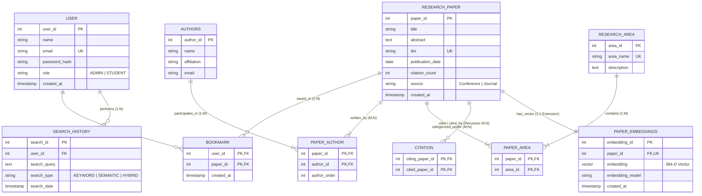

# Entity-Relationship (ER) Diagram & Specification

## 1. Overview
The **Research Paper Discovery and Semantic Recommendation System** utilizes a normalized relational data model for structured academic interactions, coupled with an unstructured document model in MongoDB and a vector embedding space in pgvector.

The relational model implements **9 core entities** in accordance with the provided Chen notation ER diagram.

---

## 2. Chen Notation ER Diagram Representation

---

## 3. Entity Specification (Chen Notation Attributes)

### Entity 1: USER
- **Attributes**: `User_ID` (Key Attribute, underlined), `Name`, `Email` (Candidate Key), `Password_Hash`, `Role` ('ADMIN' or 'STUDENT').
- **Relationships**:
  - `PERFORMS` (1:N with `SEARCH_HISTORY`)
  - `BOOKMARKS` (1:N with `RESEARCH_PAPER` via associative entity `BOOKMARK`)

### Entity 2: AUTHORS
- **Attributes**: `Author_ID` (Key Attribute, underlined), `Name`, `Affiliation`, `Email`.
- **Relationships**:
  - `WRITES` (M:N with `RESEARCH_PAPER` resolved via `PAPER_AUTHOR`)

### Entity 3: RESEARCH_PAPER
- **Attributes**: `Paper_ID` (Key Attribute, underlined), `Title`, `Abstract`, `DOI` (Candidate Key), `Publication_Date`, `Citation_Count` (Derived / Trigger maintained attribute), `Source` (Publication Venue).
- **Relationships**:
  - `WRITES` (M:N with `AUTHORS`)
  - `BELONGS_TO` (M:N with `RESEARCH_AREA`)
  - `BOOKMARKS` (M:N with `USER`)
  - `CITES` (Recursive M:N Self-Relationship: a paper can cite many papers; a paper can be cited by many papers)
  - `HAS_EMBEDDING` (1:1 Extension with `PAPER_EMBEDDINGS`)

### Entity 4: RESEARCH_AREA
- **Attributes**: `Area_ID` (Key Attribute, underlined), `Area_Name` (Unique), `Description`.
- **Relationships**:
  - `BELONGS_TO` (1:N with `PAPER_AREA`)

### Entity 5: SEARCH_HISTORY
- **Attributes**: `Search_ID` (Key Attribute, underlined), `Search_Query`, `Search_Type`, `Search_Date`.
- **Relationships**:
  - `PERFORMS` (N:1 with `USER`)

### Entity 6: CITATION (Recursive Edge)
- **Attributes**: `Citing_Paper_ID` (FK to `RESEARCH_PAPER`), `Cited_Paper_ID` (FK to `RESEARCH_PAPER`).
- **Constraint**: `citing_paper_id <> cited_paper_id` (a paper cannot cite itself).

---

## 4. Multi-Model Separation
- **PostgreSQL**: Stores the 9 relational tables and views.
- **pgvector**: Stores dense 384-dimensional sentence transformer embeddings (`PAPER_EMBEDDINGS`) linked via foreign key to `RESEARCH_PAPER`.
- **MongoDB**: Stores full-text research articles (`paper_documents`), section hierarchies (Introduction, Methodology, Results, Conclusion), citations array, and flexible unstructured metadata linked by logical foreign key `paper_id`.

